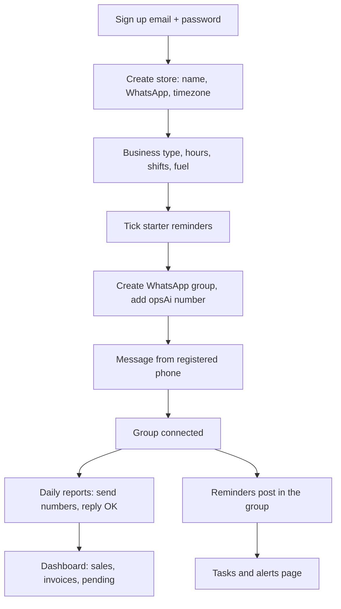

# opsAi

WhatsApp operations for **7-Eleven**, **gas stations**, **convenience stores**, and other small retail. Owners run the web app. Staff (and the owner) message one shared Cloud API number. Each store has its own WhatsApp ops group.

This is the store-owner product flow. Operator deploy steps stay in [`GO-LIVE-NEXT.md`](GO-LIVE-NEXT.md).

## What is permanent in the database

Signup and onboarding write **real Postgres rows**. They are not preview data and they do not expire.

| Saved | Table | What it means |
| --- | --- | --- |
| Account | `users` | Email + hashed password. That login is theirs until you deactivate the row. |
| Store ownership | `user_stores` | Role `OWNER`. This is the access right for the dashboard. It does not time out. |
| Owner WhatsApp | `user_directory` | Their phone, unique. Used to connect the ops group and to route 1:1 messages. |
| Store | `store_config` | Name, timezone, hours/shifts (`setup_json`). |
| Reminders | `task_templates` | What to nag about, and when. |
| Message samples | `store_config.profile_json` | Typical close / invoice wording this store uses. |
| Connected group | `store_whatsapp_groups` | Meta group id → this store. Linked the first time the registered phone messages in that group. |

The **browser session** is a JWT for 7 days. After that they sign in again with the same email and password. That is not a new account; ownership is already in `user_stores`.

Staff who join later get their own `users` row plus a `STAFF` or `MANAGER` `user_stores` row (invite code). Their WhatsApp number is added to `user_directory` when they message from a linked store.

## How a store owner uses it



### 1. Create an account

`/signup` — name, email, password, confirm password. Account is created, they are signed in, and they go to store setup.

`/login` — same email and password. If they have no store yet, they go to setup. If they already own a store, they go to the dashboard.

Google sign-in is not offered right now.

### 2. Create the store

Name, owner WhatsApp (`+1…`), timezone. That writes `store_config` + `user_stores` (OWNER) + `user_directory`.

The first store registers the phone. Extra stores reuse it — they keep messaging from the same number and name the store in the text.

### 3. Business type, hours, what to nag about

They pick **7-Eleven**, **gas station**, **convenience**, or **other**. Hours, 1–4 shifts, fuel yes/no. Then they tick items in four groups:

- **Daily reports** — send the close, bank deposit (10am), competitor gas prices, invoice photos
- **Shift reminders** — opening checklist, coffee, restock, restrooms, pumps, timed to a shift
- **Photo proofs** — 7Clean / date labels; stays open until the picture is right
- **Weekly and monthly** — fire safety, spill kit, pest report

They can paste a typical WhatsApp close (text) so this store is read the same way next time. Owners and managers edit any of this later on **Tasks & alerts → Store admin**, including adding a custom reminder.

Skip only if they will finish later on Store admin. Nothing is posted to WhatsApp until tasks exist **and** the group is connected.

### 4. Connect WhatsApp

One opsAi number for every store: **(732) 642-2700**.

1. Owner opens an **existing** store group, or creates one (for example `Main Street — ops`). Either works.
2. Adds the opsAi business number to that group.
3. From the **registered** phone, sends any message in that group.

opsAi replies that the group is connected. After that, reports and reminders belong to that store.

Until Meta approves the display name, consumer WhatsApp often shows **Invite** and the webhook never fires. Wait for **Approved**, then try a new chat. Do not SMS-invite the business number, and do not open it in the WhatsApp Business app.

A 1:1 `hi` from the registered phone can also reach the store (phone directory fallback). The intended day-to-day path is still the **group**.

### 5. Daily reporting (WhatsApp)

Staff send the day’s numbers, an invoice photo, or a short note. opsAi replies with what it understood. **OK** saves. **FIX** corrects a number. **CANCEL** drops it. Voice notes are ignored (no reply).

Typical messages:

- `Rockaway cash 106 card 334 gas 1355 deposit 1653`
- Two stores in one message, each named
- Invoice photo (needs OpenAI on the server)

Unknown numbers get one “store not linked” reply per day.

### 6. Dashboard

Sales, invoices, pending confirms, activity. Store switcher if they own more than one. **+ Add Store** either creates another location they own (`/onboarding?add=1`) or joins someone else’s store with an invite code.

### 7. Tasks & alerts

Change times, add/remove reminders, see open / done / missed. 7-Eleven can import an inspection PDF (only scores and failed standards are stored — no inspector name).

Reminders post to the group when due. Someone answers with a photo or a short code (`2 190F`). Ignored tasks escalate to the owner. Repeating tasks that are still open at the next due time are marked missed.

The scheduler must call `GET /api/cron/tasks` about every 5 minutes with `CRON_SECRET`. Hobby Vercel cannot do that itself.

### 8. Roles

| | Owner | Manager | Staff |
| --- | --- | --- | --- |
| Dashboard for their stores | yes | yes | yes |
| Create another store | yes | no | no |
| Remove a store | yes | no | no |
| Add / remove staff on Store admin | yes | yes | no |
| Add a partner as a second owner | yes | no | no |
| Change a WhatsApp number later | yes | staff numbers | no |
| Change reminders / store setup | yes | yes | no |
| Post a weekly schedule | yes | yes | no |
| Send sales / invoices / task proof | yes | yes | yes |

Two partners can both be **Owner**. Add the second person’s WhatsApp and, after they sign up, their email on **Tasks & alerts → Store admin**.

## WhatsApp cases the product already covers

These are the recorded `samples/cases-demo` paths (`npm run e2e:demo`):

1. Daily report → OK → deposit rule remembered, later mismatch warned
2. Two stores in one message
3. Wrong number, owner FIXes before save
4. Staff cannot change store configuration
5. Strangers, unsigned webhooks, duplicate Meta deliveries
6. Chatter (thanks, thumbs-up) never uses AI
7. Daily AI cap per store; typed numbers still work
8. Voice notes ignored
9. Weekly schedule posted to the group
10. Odd schedules flagged before save
11. Only owners/managers post schedules; unreadable sheets save nothing
12. Shift tasks stay open until proof
13. A task reply never swallows a sales message; ignored tasks escalate
14. Repeating tasks marked missed; removed tasks stop nagging
15. 7-Eleven limits and fallbacks (cold holding, broken printer)
16. Recurring tasks and photo checks

## What is live today vs this repo

**Live `opsai.us`** (last production deploy) has the WhatsApp number, webhook, and database. It still shows Google on login/signup, a short “create store” onboarding (no business-type / reminders wizard), and **no** `/tasks` page.

**This working tree** has email/password registration, the full owner wizard, and Tasks & alerts. It is not on production until it is committed and deployed.

Before first real owners:

1. Wait for WhatsApp display name **Approved**, then a real `hi` from a personal phone — Vercel should log a POST to `/api/webhook/whatsapp`.
2. Deploy this tree.
3. Run `scripts/add-tasks.sql` in Supabase (safe twice). Without it the tasks page errors.
4. Set `ADMIN_API_KEY` and a new `STORE_LINK_INVITE_CODE` on Vercel (readiness currently flags both missing).
5. Point an external scheduler at `/api/cron/tasks` if you want reminders.
6. Optional: `OPENAI_EXTRACTION_MODEL` for photos. Typed numbers work without it.

## Local

```bash
cp .env.example .env   # fill secrets locally; never commit .env
npm install
npx prisma generate
npm run preview        # UI with sample data, no database: http://localhost:3100/dashboard?token=preview
```

`npm test` runs unit tests. `npm run e2e:demo` plays the WhatsApp cases above.

Hobby Vercel allows **12 serverless functions**; keep only route files under `api/`.
